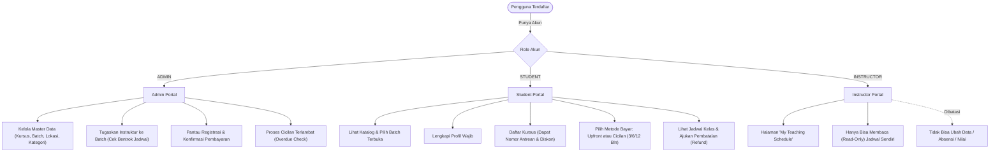
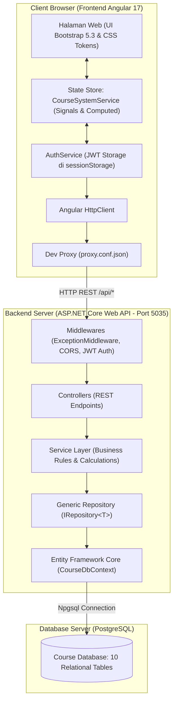
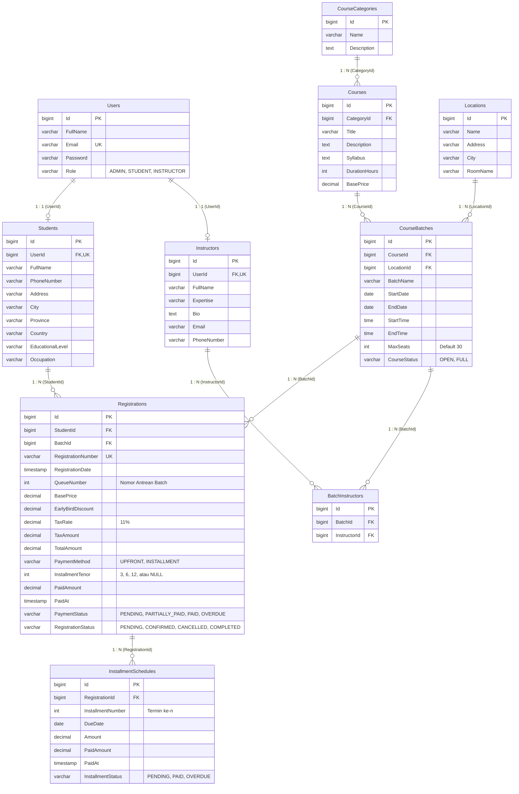
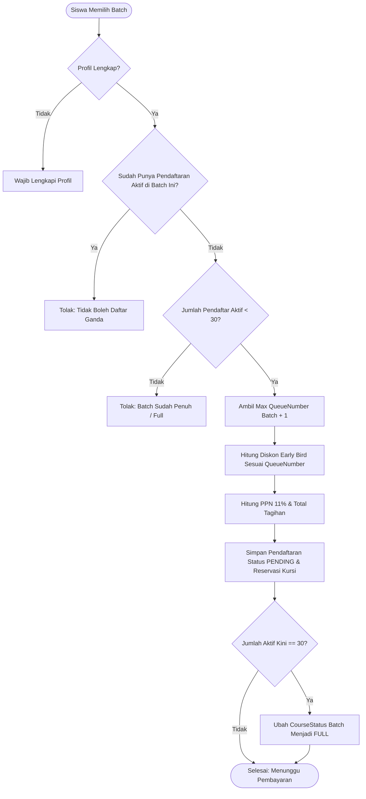
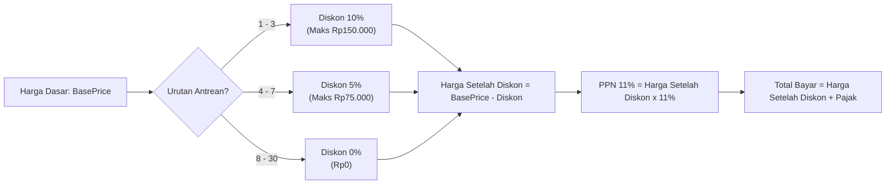
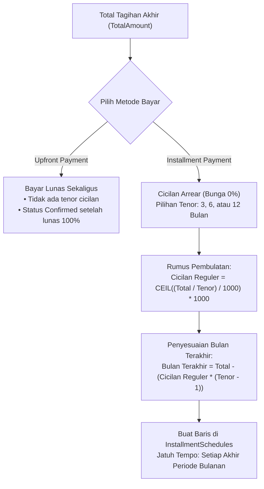
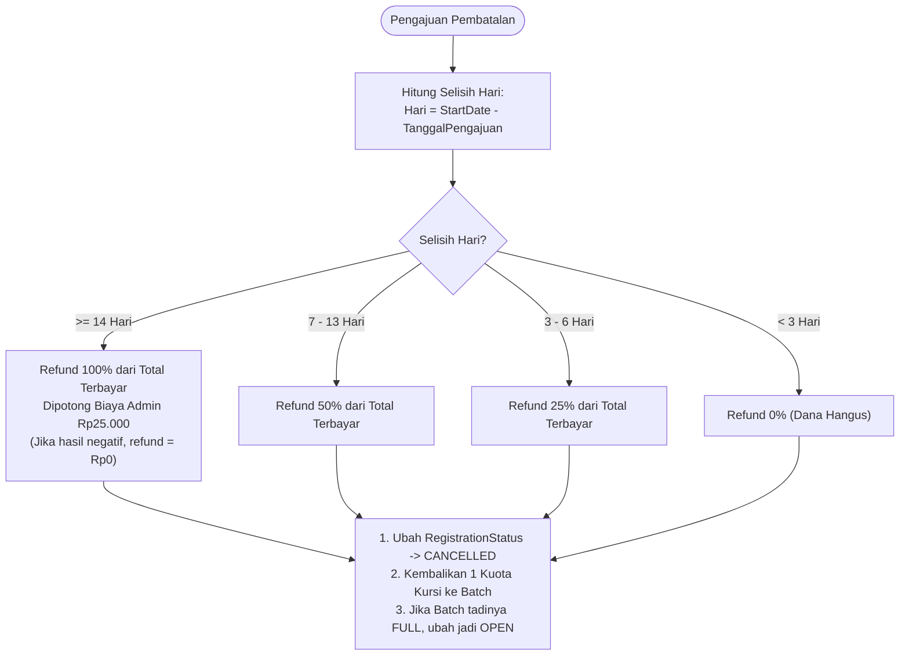
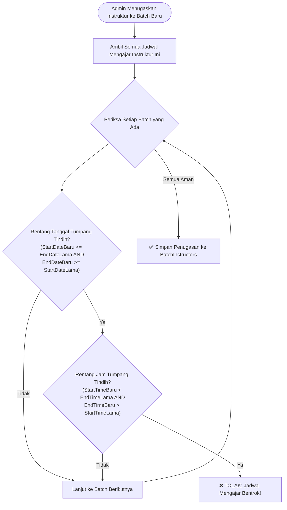
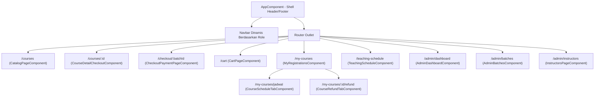

# 📘 Panduan Lengkap Sistem Kursus Tatap Muka (Karsa Studio)
> **Offline Course Registration System — Kelompok 3**
> Dokumen ini dirancang sebagai panduan komprehensif untuk memahami arsitektur, basis data, alur bisnis, serta kode program Backend (.NET 9) dan Frontend (Angular 17).

---

## 📑 Daftar Isi
1. [Gambaran Umum & Domain Bisnis](#1-gambaran-umum--domain-bisnis)
2. [Arsitektur Sistem End-to-End](#2-arsitektur-sistem-end-to-end)
3. [Pemodelan Basis Data (10 Tabel Relasional)](#3-pemodelan-basis-data-10-tabel-relasional)
4. [Alur Bisnis Inti & Visualisasi](#4-alur-bisnis-inti--visualisasi)
   - [4.1 Pendaftaran & Reservasi Kuota Kursi (Maks. 30)](#41-pendaftaran--reservasi-kuota-kursi-maks-30)
   - [4.2 Diskon Bertingkat (Early Bird) & Pajak 11%](#42-diskon-bertingkat-early-bird--pajak-11)
   - [4.3 Skema Pembayaran: Upfront vs Installment Arrear](#43-skema-pembayaran-upfront-vs-installment-arrear)
   - [4.4 Kebijakan Pembatalan & Refund](#44-kebijakan-pembatalan--refund)
   - [4.5 Deteksi Bentrok Jadwal Mengajar Instruktur](#45-deteksi-bentrok-jadwal-mengajar-instruktur)
5. [Bedah Kode Backend (.NET Core 9 Web API)](#5-bedah-kode-backend-net-core-9-web-api)
   - [5.1 Arsitektur Berlapis (Layered Pattern)](#51-arsitektur-berlapis-layered-pattern)
   - [5.2 Autentikasi JWT & Role Claims](#52-autentikasi-jwt--role-claims)
   - [5.3 Bedah Logika RegistrationService.cs](#53-bedah-logika-registrationservicecs)
   - [5.4 Bedah Logika BatchInstructorService.cs](#54-bedah-logika-batchinstructorservicecs)
6. [Bedah Kode Frontend (Angular 17 Standalone & Signals)](#6-bedah-kode-frontend-angular-17-standalone--signals)
   - [6.1 Arsitektur Komponen & Routing](#61-arsitektur-komponen--routing)
   - [6.2 State Management dengan Angular Signals](#62-state-management-dengan-angular-signals)
   - [6.3 Route Guards & Proteksi Akses](#63-route-guards--proteksi-akses)
7. [Panduan Menjalankan & Menguji Proyek](#7-panduan-menjalankan--menguji-proyek)

---

## 1. Gambaran Umum & Domain Bisnis

Aplikasi ini mengelola pendaftaran kursus teknologi tatap muka (*offline*) di ruang kelas fisik di berbagai lokasi (seperti Jakarta Selatan, Jakarta Pusat, dan Bandung).

### 👥 Peran Pengguna (Roles)
Sistem memiliki **3 role** dengan batasan hak akses yang tegas:



---

## 2. Arsitektur Sistem End-to-End

Sistem dibangun dengan memisahkan aplikasi Frontend dan Backend yang berkomunikasi melalui protokol REST API via JSON:



---

## 3. Pemodelan Basis Data (10 Tabel Relasional)

Skema database dirancang dengan 10 entitas yang saling terhubung erat secara relasional:



### 🔑 Aturan Integritas Data Penting:
1. **Pencegahan Data Duplikat**:
   * Pasangan `(BatchId, InstructorId)` pada `BatchInstructors` bersifat **UNIK** agar pengajar tidak ditugaskan dua kali pada batch yang sama.
   * Pasangan `(RegistrationId, InstallmentNumber)` pada `InstallmentSchedules` bersifat **UNIK**.
   * `RegistrationNumber` bersifat **UNIK** dengan format: `REG-yyyyMMdd-{BatchId}-{QueueNumber:D3}`.
2. **Snapshot Transaksional**:
   * Tabel `Registrations` menyimpan nilai snapshot: `BasePrice`, `EarlyBirdDiscount`, `TaxRate`, dan `TotalAmount`. Jika harga dasar kursus di kemudian hari naik, riwayat transaksi peserta lama tidak akan terpengaruh.

---

## 4. Alur Bisnis Inti & Visualisasi

### 4.1 Pendaftaran & Reservasi Kuota Kursi (Maks. 30)

Setiap batch fisik hanya memiliki **30 kursi**. Kursi direservasi seketika saat pendaftaran dibuat (status `PENDING`), bukan saat selesai bayar, guna mencegah *race condition* atau kelebihan kapasitas (*overselling*).



---

### 4.2 Diskon Bertingkat (Early Bird) & Pajak 11%

Diskon diberikan secara adil berdasarkan urutan pendaftaran (`QueueNumber`) pada masing-masing batch:

| Tingkatan (Tier) | Urutan Pendaftar (`QueueNumber`) | Persentase Diskon | Batas Maksimal Potongan |
| :--- | :--- | :--- | :--- |
| **Tier 1** | Pendaftar ke-1 s/d ke-3 | **10%** dari BasePrice | Maksimal **Rp150.000** |
| **Tier 2** | Pendaftar ke-4 s/d ke-7 | **5%** dari BasePrice | Maksimal **Rp75.000** |
| **Reguler** | Pendaftar ke-8 s/d ke-30 | **0%** (Tidak ada diskon) | Rp0 |



> ⚠️ **Catatan Penting**: Nilai `QueueNumber` bersifat **inkremental dan permanen**. Jika pendaftar nomor 2 membatalkan pesanan, pendaftar berikutnya tetap mendapat nomor 3, 4, dst. Nomor antrean tidak digunakan ulang demi menjaga catatan audit.

---

### 4.3 Skema Pembayaran: Upfront vs Installment Arrear

Sistem mendukung 2 metode pembayaran dengan dasar total tagihan yang identik (bunga cicilan 0%):



#### Contoh Simulasi Nyata:
* Kursus Backend: `BasePrice = Rp1.000.000`
* Pendaftar pertama (Tier 1, diskon 10% = Rp100.000)
* Harga setelah diskon = `Rp900.000`
* Pajak PPN 11% = `Rp99.000`
* **Total Tagihan = Rp999.000**

Jika memilih **Cicilan 3 Bulan**:
1. Cicilan Reguler: $\lceil \frac{999.000}{3 \times 1.000} \rceil \times 1.000 = \text{Rp333.000}$
2. Bulan ke-1: **Rp333.000**
3. Bulan ke-2: **Rp333.000**
4. Bulan ke-3: $999.000 - (333.000 \times 2) = \textbf{Rp333.000}$
*Pendaftaran langsung berstatus `CONFIRMED` seketika cicilan bulan pertama berhasil dibayar.*

---

### 4.4 Kebijakan Pembatalan & Refund

Peserta dapat membatalkan pendaftaran sebelum batch kelas dimulai. Besar pengembalian dana (*refund*) bergantung pada selisih hari pengajuan terhadap tanggal mulai kelas (`StartDate`):



---

### 4.5 Deteksi Bentrok Jadwal Mengajar Instruktur

Sebelum Admin menetapkan instruktur ke batch, sistem backend memeriksa bentrok jadwal terhadap seluruh batch yang pernah ditugaskan kepada instruktur tersebut:



---

## 5. Bedah Kode Backend (.NET Core 9 Web API)

### 5.1 Arsitektur Berlapis (Layered Pattern)
Kode backend diatur rapi mengikuti pola *Clean Architecture / Layered Architecture*:
* **Controllers** (`BackEnd/Controllers`): Menerima HTTP request, memvalidasi model state, mengekstrak user claims dari token JWT, dan mengembalikan response HTTP (200, 201, 400, 404).
* **Services** (`BackEnd/Services`): Pusat logika bisnis murni (perhitungan diskon, pengecekan bentrok, aturan refund, transaksi database).
* **Repositories** (`BackEnd/Repositories`): Menjembatani database menggunakan generic `IRepository<T>` untuk operasi CRUD dan eager loading (`Include`).
* **Middlewares** (`BackEnd/Middlewares`): Menangani error global secara terpusat ([ExceptionMiddleware.cs](file:///E:/projects/kelompok-3/BackEnd/Middlewares/ExceptionMiddleware.cs)).

---

### 5.2 Autentikasi JWT & Role Claims
Pada [AuthService.cs](file:///E:/projects/kelompok-3/BackEnd/Services/AuthService.cs#L80-L99), token JWT dibuat dengan menanamkan klaim identitas penting:

```csharp
var claims = new List<Claim>
{
    new Claim(JwtRegisteredClaimNames.Sub, user.Id.ToString()),
    new Claim(JwtRegisteredClaimNames.Email, user.Email),
    new Claim(ClaimTypes.Name, user.FullName),
    new Claim(ClaimTypes.Role, user.Role.ToString()) // ADMIN, STUDENT, INSTRUCTOR
};

// Khusus Student, sertakan Id profil Student
var student = await _studentRepository.FirstOrDefaultAsync(s => s.UserId == user.Id);
if (student != null)
    claims.Add(new Claim("StudentId", student.Id.ToString()));
```

Dengan adanya claim `"StudentId"`, controller pendaftaran dapat langsung mengetahui siapa siswa yang memesan tanpa perlu *query* ulang:
```csharp
var studentId = User.FindFirst("StudentId")?.Value;
```

---

### 5.3 Bedah Logika `RegistrationService.cs`
File: [BackEnd/Services/RegistrationService.cs](file:///E:/projects/kelompok-3/BackEnd/Services/RegistrationService.cs)

#### 1. Validasi Kapasitas & Registrasi Ganda:
```csharp
var activeRegistrations = batchRegistrations
    .Where(r => r.RegistrationStatus == RegistrationStatus.PENDING ||
                r.RegistrationStatus == RegistrationStatus.CONFIRMED)
    .ToList();

if (activeRegistrations.Count >= batch.MaxSeats)
    throw new Exception("Kapasitas batch sudah penuh.");

bool duplicate = activeRegistrations.Any(r => r.StudentId == studentId);
if (duplicate)
    throw new Exception("Student sudah memiliki pendaftaran aktif pada batch ini.");
```

#### 2. Penentuan Nomor Antrean & Early Bird:
```csharp
int queueNumber = batchRegistrations
    .Select(r => r.QueueNumber)
    .DefaultIfEmpty(0)
    .Max() + 1;

decimal discountPercentage = 0m;
decimal maximumDiscount = 0m;

if (queueNumber >= 1 && queueNumber <= 3) {
    discountPercentage = 0.10m;
    maximumDiscount = 150000m;
} else if (queueNumber >= 4 && queueNumber <= 7) {
    discountPercentage = 0.05m;
    maximumDiscount = 75000m;
}
```

#### 3. Update Status Batch Otomatis:
```csharp
batch.CourseStatus = (activeRegistrations.Count + 1 >= batch.MaxSeats)
    ? CourseBatchStatus.FULL
    : CourseBatchStatus.OPEN;

_batchRepository.Update(batch);
await _registrationRepository.AddAsync(registration);
await _registrationRepository.SaveChangesAsync();
```

---

### 5.4 Bedah Logika `BatchInstructorService.cs`
File: [BackEnd/Services/BatchInstructorService.cs](file:///E:/projects/kelompok-3/BackEnd/Services/BatchInstructorService.cs)

Memeriksa bentrok jadwal sebelum menyimpan data penugasan:
```csharp
foreach (var assignment in instructorAssignments)
{
    var existingBatch = assignment.CourseBatch;

    // Evaluasi tumpang tindih tanggal
    bool dateOverlap = existingBatch.StartDate <= courseBatch.EndDate &&
                       existingBatch.EndDate >= courseBatch.StartDate;

    // Evaluasi tumpang tindih jam
    bool timeOverlap = existingBatch.StartTime < courseBatch.EndTime &&
                       existingBatch.EndTime > courseBatch.StartTime;

    if (dateOverlap && timeOverlap)
    {
        throw new Exception("Instruktur sudah memiliki jadwal mengajar yang bentrok.");
    }
}
```

---

## 6. Bedah Kode Frontend (Angular 17 Standalone & Signals)

### 6.1 Arsitektur Komponen & Routing
FrontEnd menggunakan arsitektur **Angular Standalone Components** (tanpa `NgModule`) dengan tree komponen sebagai berikut:



---

### 6.2 State Management dengan Angular Signals
File: [FrontEnd/src/app/services/course-system.service.ts](file:///E:/projects/kelompok-3/FrontEnd/src/app/services/course-system.service.ts)

Aplikasi memanfaatkan fitur reaktivitas modern Angular: `signal` dan `computed`:
```typescript
// Sinyal reaktif data user yang sedang login
readonly currentUser = computed<User | null>(() => {
  const user = this.auth.user();
  if (user?.role !== 'Student') return user;
  const profile = this.students().find(student => student.userId === user.id);
  return profile ? { ...user, fullName: profile.fullName } : user;
});

// Perhitungan dinamis sisa kursi untuk batch tertentu
getRemainingSeatsForBatch(batchId: number): number {
  const b = this.getBatchById(batchId);
  if (!b) return 0;
  return Math.max(0, b.maxSeats - this.getUsedSeatsForBatch(batchId));
}
```

Di komponen checkout ([checkout-payment.component.ts](file:///E:/projects/kelompok-3/FrontEnd/src/app/pages/checkout-payment/checkout-payment.component.ts)), rincian harga dihitung otomatis seketika melalui `computed`:
```typescript
readonly priceBreakdown = computed(() => {
  const crs = this.course();
  const b = this.batch();
  if (!crs || !b) return null;
  const nextQueue = this.svc.getNextQueueNumberForBatch(b.id);
  return this.svc.calculatePriceBreakdown(crs.basePrice, nextQueue);
});
```

---

### 6.3 Route Guards & Proteksi Akses
File: [FrontEnd/src/app/guards/role.guard.ts](file:///E:/projects/kelompok-3/FrontEnd/src/app/guards/role.guard.ts)

Melindungi rute secara fungsional (*functional guards*):
1. **`adminOnlyGuard`**: Memeriksa apakah `currentUser().role === 'Admin'`. Jika bukan admin, diarahkan kembali ke `/courses`.
2. **`instructorScheduleGuard`**: Memeriksa apakah role adalah `Instructor` atau `Admin`. Mengamankan halaman jadwal mengajar.

---

## 7. Panduan Menjalankan & Menguji Proyek

### 🛠️ Prasyarat (Prerequisites)
* [.NET 9 SDK](https://dotnet.microsoft.com/)
* [Node.js (v18+) & npm](https://nodejs.org/)
* [PostgreSQL](https://www.postgresql.org/) (Server lokal port 5432)

---

### 🚀 Menjalankan Backend (.NET 9)
1. Buka PowerShell dan masuk ke folder `BackEnd`:
   ```powershell
   cd BackEnd
   ```
2. Pastikan file [appsettings.json](file:///E:/projects/kelompok-3/BackEnd/appsettings.json) memiliki *Connection String* PostgreSQL yang valid:
   ```json
   "ConnectionStrings": {
     "Course": "Host=localhost;Database=Course;Username=postgres;Password=postgres;"
   }
   ```
3. Terapkan migrasi database:
   ```powershell
   dotnet ef database update
   ```
4. Jalankan aplikasi Backend:
   ```powershell
   dotnet run --launch-profile http
   ```
   * Backend aktif di: `http://localhost:5035`
   * Swagger OpenAPI Docs: `http://localhost:5035/swagger`

---

### 💻 Menjalankan Frontend (Angular 17)
1. Buka PowerShell baru dan masuk ke folder `FrontEnd`:
   ```powershell
   cd FrontEnd
   ```
2. Jalankan aplikasi web:
   ```powershell
   npm start
   ```
   * Frontend aktif di: `http://localhost:4200`
   * Semua panggilan `/api/*` otomatis diteruskan (*proxied*) ke `http://localhost:5035` via [proxy.conf.json](file:///E:/projects/kelompok-3/FrontEnd/proxy.conf.json).

---

### 🔑 Kredensial Pengujian (Seeding Data)
Gunakan akun uji coba yang telah disediakan pada [BackEnd/seed-data-manual.sql](file:///E:/projects/kelompok-3/BackEnd/seed-data-manual.sql):

| Role | Email | Password | Kegunaan Uji Coba |
| :--- | :--- | :--- | :--- |
| **Admin** | `admin@kursus.com` | `Admin@2026!` | Menguji manajemen kursus, batch, instruktur, dan konfirmasi pembayaran |
| **Student** | `budi@gmail.com` | `Budi@2026!` | Menguji pendaftaran, checkout, jadwal belajar, dan refund |
| **Student** | `siti@gmail.com` | `Siti@2026!` | Menguji profil belum lengkap / pengujian antrean baru |
| **Instructor** | `andi@kursus.com` | `Andi@2026!` | Menguji halaman *My Teaching Schedule* (Backend Track) |
| **Instructor** | `dewi@kursus.com` | `Dewi@2026!` | Menguji halaman *My Teaching Schedule* (Data Science Track) |

---
*Dokumen ini dibuat otomatis sebagai bahan pembelajaran mandiri dan pemahaman kode Offline Course Registration System (Kelompok 3).*
